# LearnLoom frontend

The LearnLoom frontend is a responsive learning workspace. Learners can try the chat, schedule revisions, and review test results. The class, group, organisation, and admin views show how student rosters, assessments, and progress fit together. The app uses React, JavaScript, Vite, React Router, Material UI, and Emotion.

## Run locally

Use Node.js 24 and npm. Run these commands from the repository root.

```sh
cd frontned
npm install
npm run dev
```

Open the local URL printed by Vite, usually [http://localhost:5173](http://localhost:5173). The sample workspace runs without environment variables or service credentials.

## Explore the sample workspace

Choose **Explore sample workspace** on the login screen to open the learner dashboard without signing in. Use **Preview dashboard** in the header to switch between Learner, Class, Group, Organisation, and Admin, or paste a route from the guide below after the local server URL.

The dashboard has a persistent sidebar on desktop and a navigation drawer on smaller screens. The menu shows pages for the current view, a **New Chat** button, and conversation history for the current sample learner. Use **Reset demo** in the navigation to restore the original records and return to the learner dashboard. A page refresh also restores the sample data because changes are kept in memory.

## Sign-in and account pages

### Login

The home route `/` redirects to `/login`. The page validates the email and password fields, and the password can be shown or hidden. **Sign in** displays the result of a local demo credential check. **Forgot password?** displays a placeholder notice, and **Keep me signed in** is a form control for the preview.

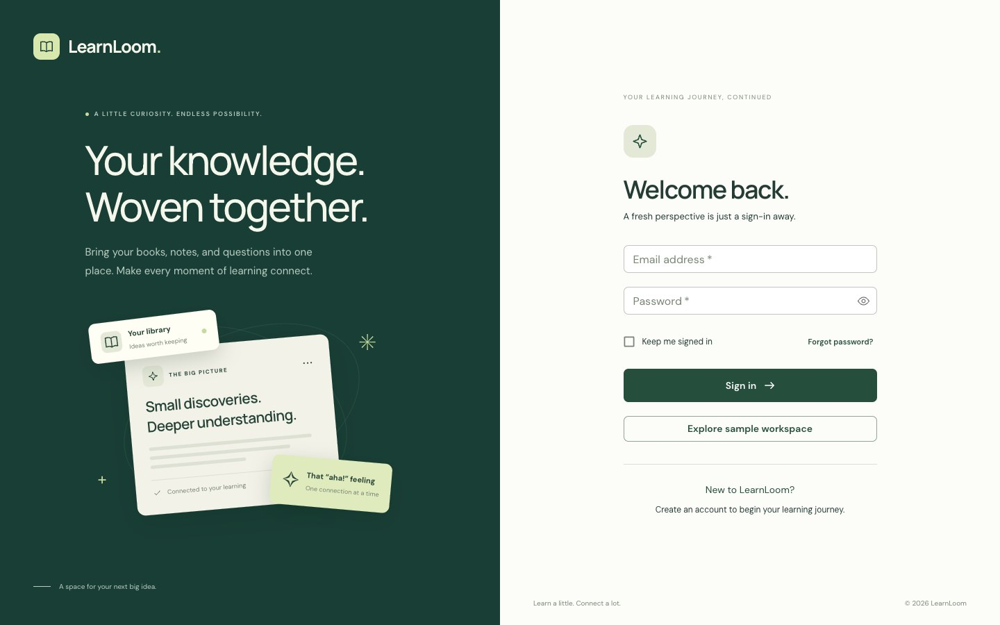

### Signup

At `/signup`, **Create account** validates a full name, an email address, a password of at least eight characters, and matching password confirmation. A valid submission displays a placeholder notice. The screen links back to login.

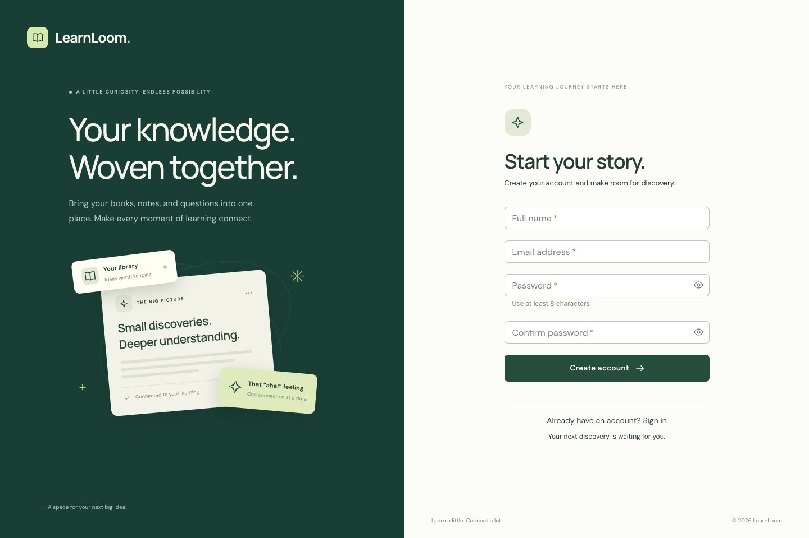

## Learner pages

### Chat

Open `/user/1` to start with an empty chat and suggested prompts. Select a prompt or type a question and choose **Send message** to see a sample reply. **Previous conversations** in the sidebar contains seeded chats, and **New Chat** starts a separate conversation. Conversation history is scoped to the current sample learner and can be opened from any dashboard view.

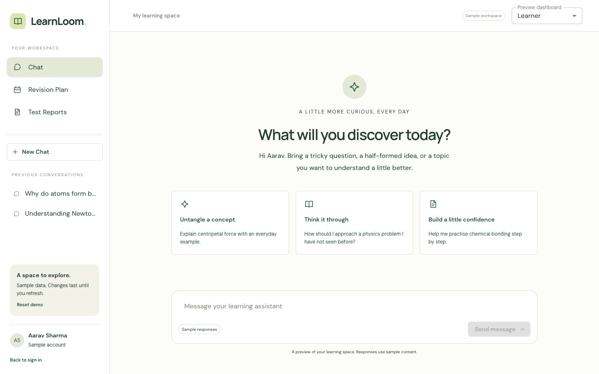

#### Passage actions

Open **Why do atoms form bonds?** at `/user/1/chat/chat-2` and select text within one assistant reply to save the highlight and open its action menu. Select the saved highlight again to reopen it.

| Action                       | What happens                                                                                                         |
| ---------------------------- | -------------------------------------------------------------------------------------------------------------------- |
| **Ask more**                 | Adds a follow-up question and the selected quote to the main conversation.                                           |
| **Add note**                 | Saves a personal note on the highlight. Reopen the action to edit the note.                                          |
| **Create side conversation** | Opens a discussion tied to the passage, with its own messages and a link back to the original quote.                 |
| **Learn later**              | Schedules a revision with a date and time in the displayed time zone. Reopen the action to reschedule the same item. |

The screenshots show the same chat opened from the admin dashboard at `/admin/chat/chat-2`.

| Wider viewport                                                                                  | Mobile viewport                                                                                                          |
| ----------------------------------------------------------------------------------------------- | ------------------------------------------------------------------------------------------------------------------------ |
| 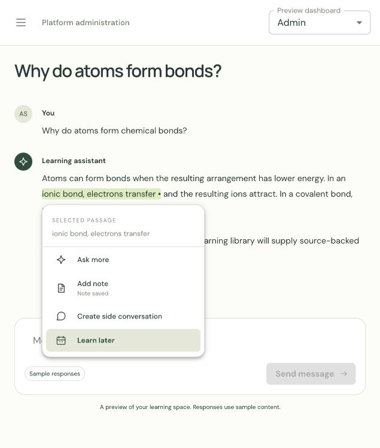 | 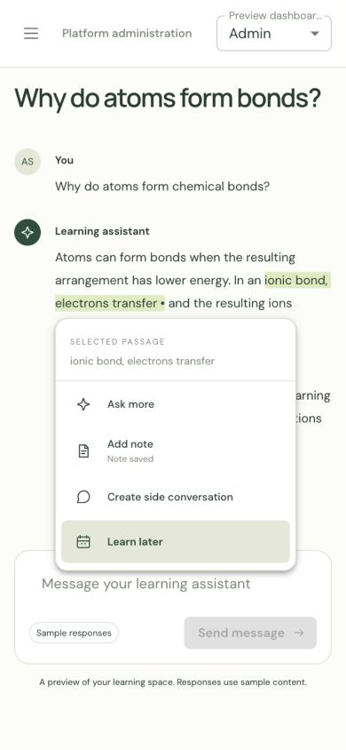 |

### Revision Plan

Open `/user/1/revisions` from **Revision Plan** in the learner navigation. The page counts planned and completed items and offers two views.

- **Calendar** opens on the current month. Move between months or use **Today** to jump back. Select a date to plan a revision for that day, or select an existing item to edit it.
- **Grid** shows revision cards with their dates and status. Use **Edit / reschedule** to change a revision, **Mark complete** when it is done, or **Mark as planned** to reopen it.

**Plan a revision** creates an item with a title, date, and optional description. Revisions created from a chat passage also show the scheduled time and a **Back to passage** link in Grid view. The **Learn later** dialog shows the disconnected status of WhatsApp and Google Calendar.

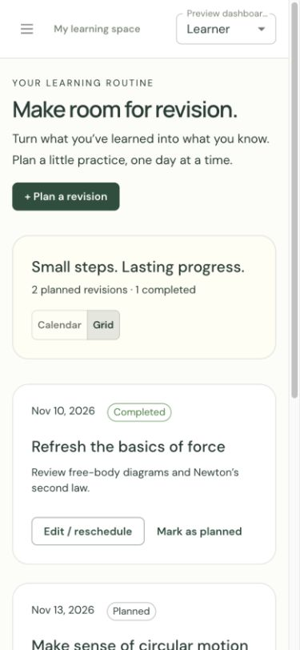

### Test Reports

Open `/user/1/tests` to see how many tests were attempted and how many reports are ready. Attempts appear newest first with the subject, test name, attempt date, and score or pending status. **View report** opens an evaluated attempt, and **View status** opens an attempt marked **Processing**.

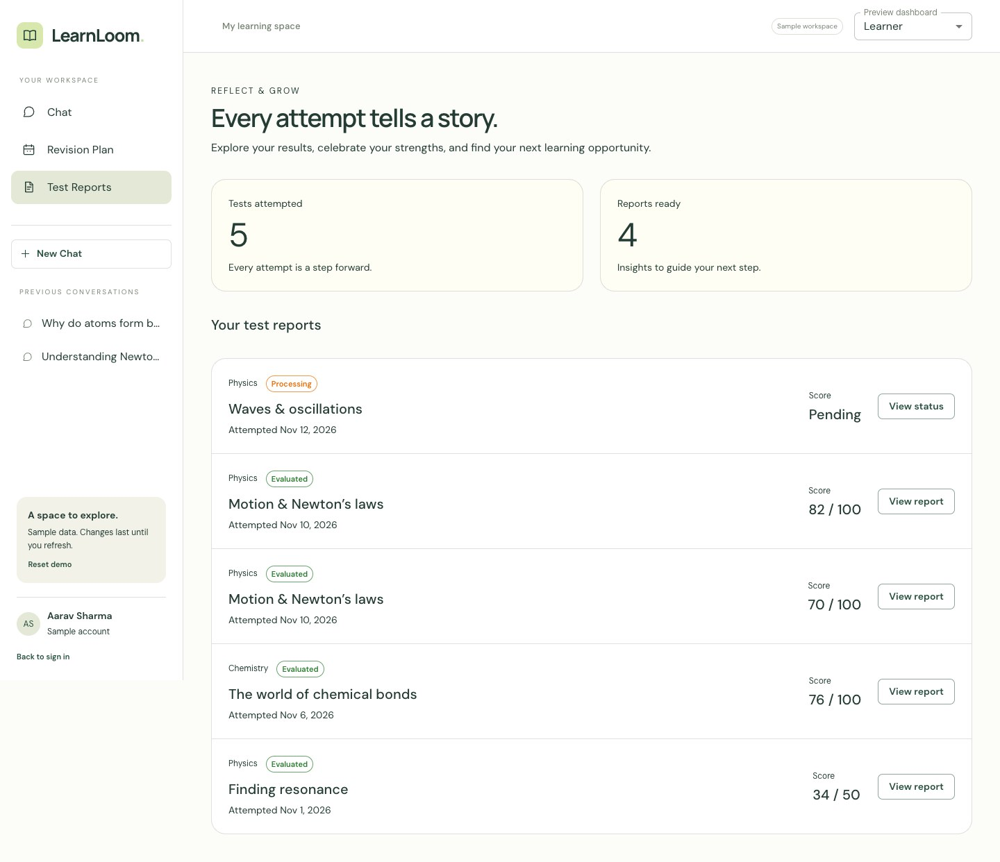

### Report details

Open `/user/1/tests/attempt-1` to see an evaluated Physics report with the score, strengths, and topics to revisit. Expand a question to compare the selected answer with the correct answer and read its explanation where provided. Use **Plan a revision** to create a revision prefilled with topics from the report. Open `/user/1/tests/attempt-3` to see the processing state.

Class and group report links open the same report layout in a student context. The page shows the student’s name and a link back to the roster. For example, `/org/1/class/1/students/1/reports/attempt-1` opens a class report.

**Evaluated report**

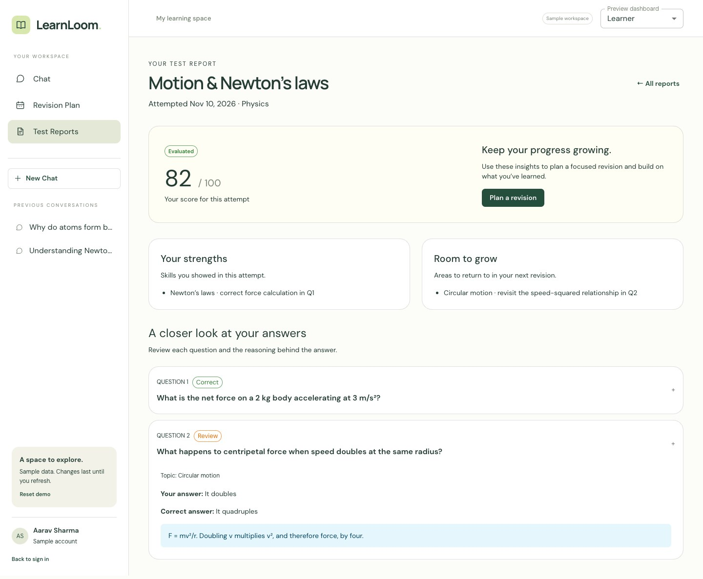

**Report awaiting evaluation**

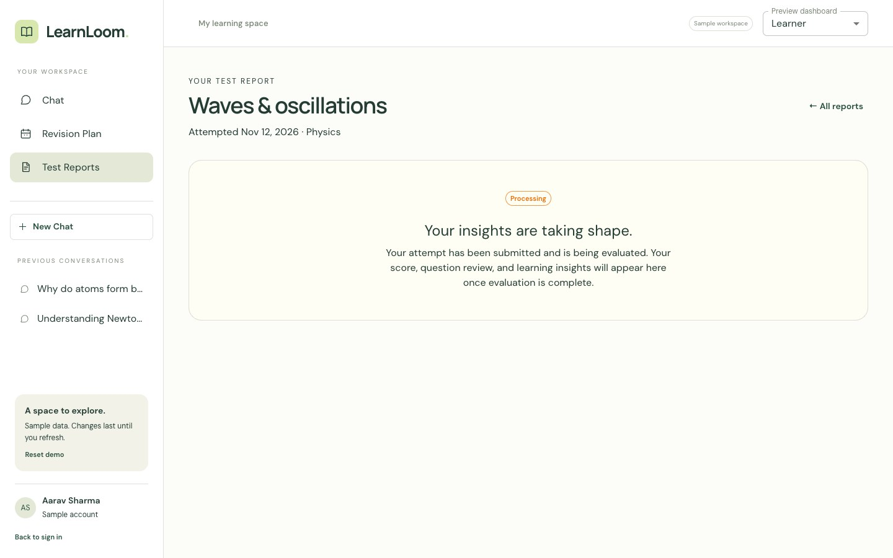

## Class and group pages

Classes and groups share the same navigation and pages. The examples below use **Class 12 · Science** at `/org/1/class/1`. To explore the same pages in a standalone group, use `/group/1` for **Physics Circle** with the same `/students`, `/invite`, `/tests`, and `/progress` suffixes.

### Students / Users

Open `/org/1/class/1` or `/org/1/class/1/students`. Search the roster by name or email. Each row shows a learning profile, evaluated attempt count, average score for this class, and a link to the student’s latest evaluated report when available. The **Invitations** table lists email addresses and their status.

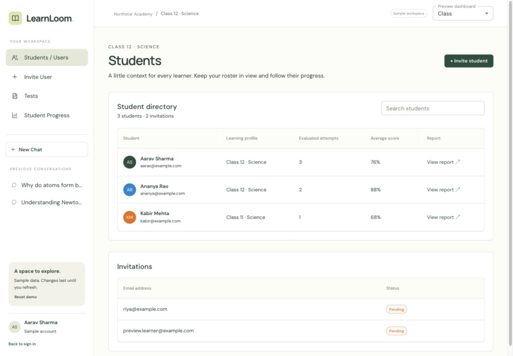

### Invite User

Open `/org/1/class/1/invite` from the sidebar, or choose **Invite student** above the roster. Enter an email address and choose **Create invitation**. The form checks the email format, existing membership, and duplicate invitations for the same class or group. A successful submission adds a **Pending** row to the demo. Preview invitations stay in the browser.

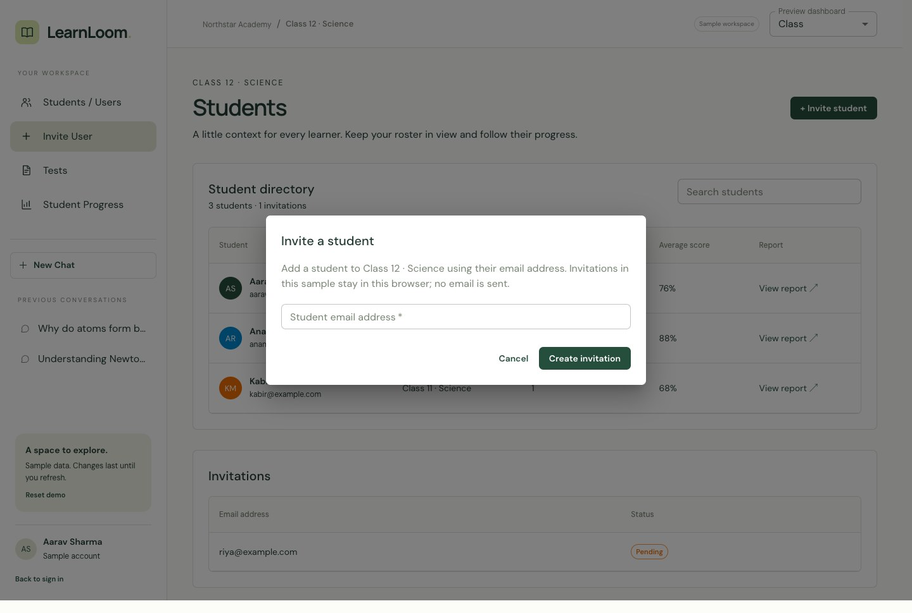

### Tests

Open `/org/1/class/1/tests` to see published and draft assessments, evaluated attempt totals, and the average score. Each assessment row includes the subject, date, question count, maximum marks, materials, and status.

Choose **Create test** to enter a title, subject, date, question count, and maximum marks. The form also accepts question paper and answer key file selections and a marking scheme. **Create draft test** adds a **Draft** row. The preview stores the selected filenames in memory.

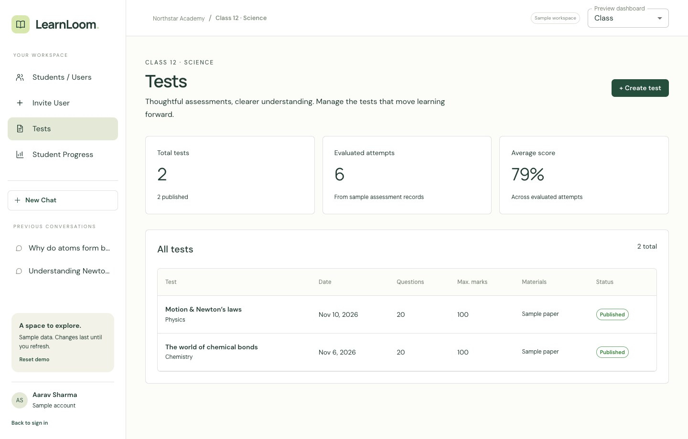

### Student Progress

Open `/org/1/class/1/progress` to see the average score and how many students have an evaluated attempt. The score change compares the first and latest assessment averages in percentage points when enough results exist. A chart and a table show the assessment averages and the number of evaluated attempts behind each point.

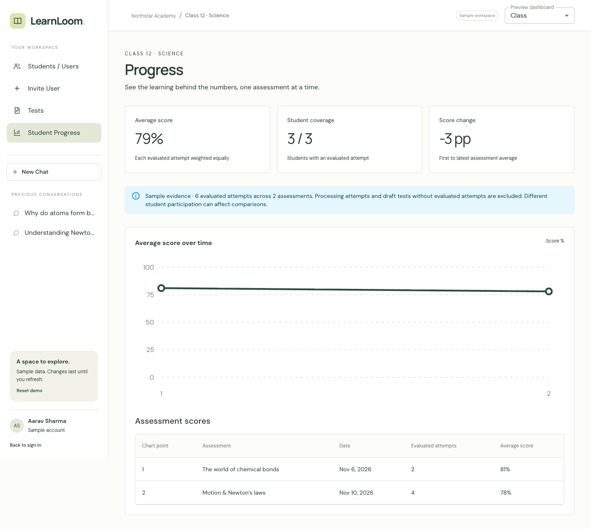

## Organisation page

### Groups & Classes

Open `/org/1` to view **Northstar Academy**. The overview counts unique students across the organisation and lists its classes and groups with student counts, test totals, and average scores. Use the links in the list to open a workspace such as `/org/1/class/1` or `/org/1/group/2`. **Add class** and **Add group** open creation forms with the organisation already selected.

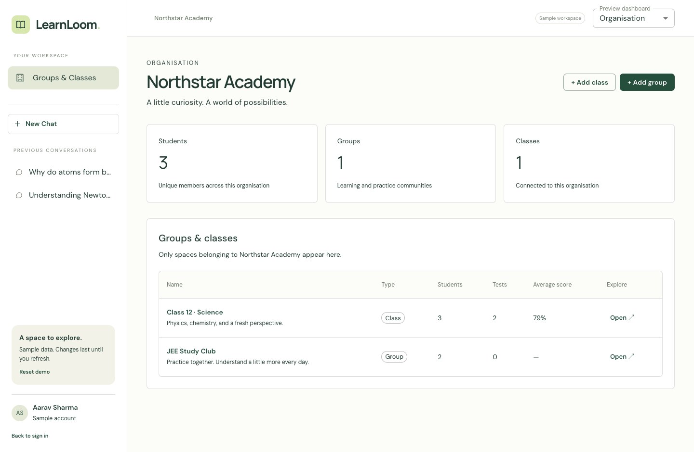

## Admin pages

### Organisations & groups

Open `/admin` to browse all sample organisations, classes, and groups. Search by name or description, filter by type, or use the organisation filter to show a specific organisation or standalone workspaces. Open a result to see its dashboard. **Create new** opens a menu for creating an organisation, group, or class and takes you to the new workspace after saving.

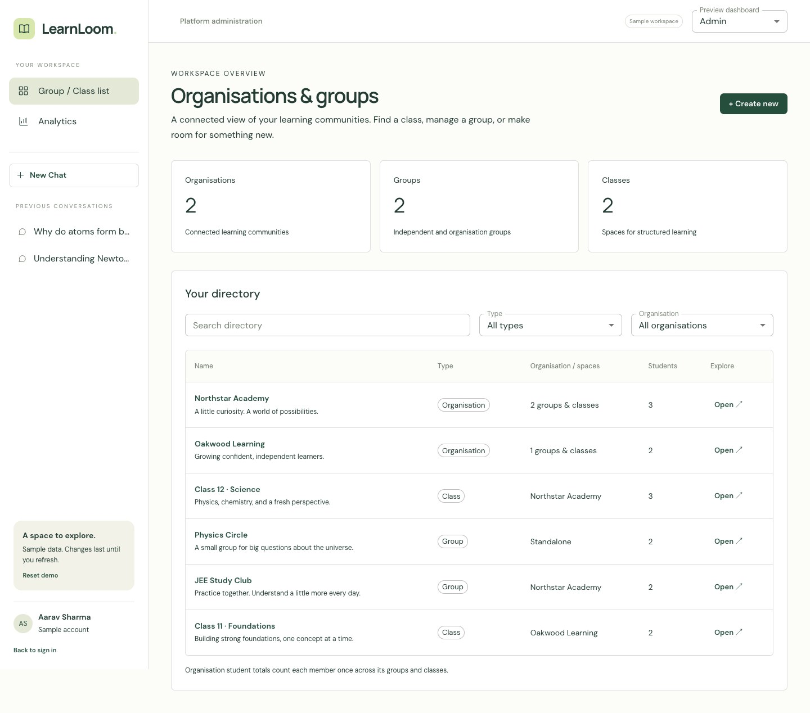

### Learning analytics

Open `/admin/analytics` to see user and workspace totals, evaluated and processing attempt counts, the average score, and the number of published tests. **Assessment score overview** shows an assessment-level chart and table. **Community overview** lists each class or group with its student count, tests, evaluated attempts, and average score. Platform-wide totals count unique students, who can belong to more than one community.

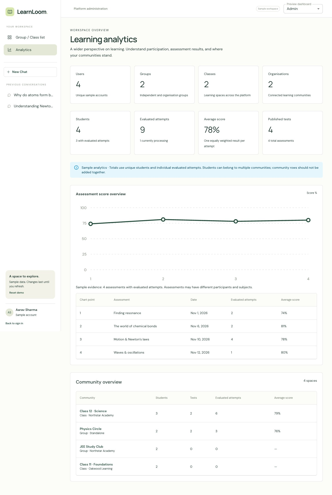

## Missing pages and records

An unknown top-level path shows a 404 with a link back to sign-in. Unknown subpages inside a valid workspace keep its navigation visible. Invalid sample IDs show a workspace, conversation, or report empty state depending on the route.

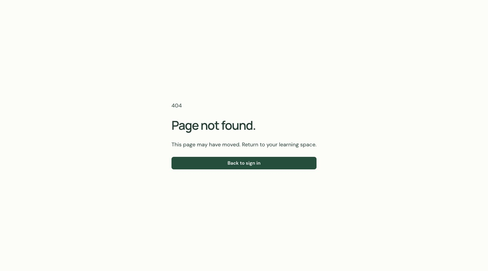

## Project structure

| Location                                                      | Responsibility                                               |
| ------------------------------------------------------------- | ------------------------------------------------------------ |
| [`src/app/`](src/app/) and [`src/routes/`](src/routes/)       | App providers, route definitions, and navigation paths       |
| [`src/layouts/`](src/layouts/) and [`src/theme/`](src/theme/) | Shared layouts and Material UI theme                         |
| [`src/features/auth/`](src/features/auth/)                    | Login and signup screens, form state, and validation         |
| [`src/features/dashboard/`](src/features/dashboard/)          | Dashboard screens, chat, revisions, reports, and sample data |
| [`src/shared/`](src/shared/)                                  | Shared components and public app configuration               |

## Development commands

Run these from `frontned/`.

| Command                | Purpose                                            |
| ---------------------- | -------------------------------------------------- |
| `npm test`             | Run the Vitest suite.                              |
| `npm run check:files`  | Check the 300-line limit for source files.         |
| `npm run format:check` | Check formatting with Prettier.                    |
| `npm run format`       | Apply Prettier formatting.                         |
| `npm run build`        | Build the frontend into `dist/`.                   |
| `npm run preview`      | Serve the production build locally after building. |

For static hosting, publish `dist/` and route direct requests for client-side pages back to `index.html`. The Vercel rewrite is already defined in [`vercel.json`](vercel.json).
